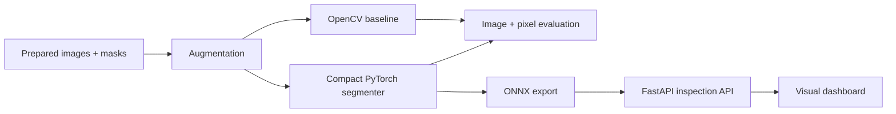

# VisionInspect

An industrial computer-vision reference system for defect detection, pixel-level segmentation, reproducible evaluation, optimized ONNX inference, and human-facing visual inspection.



## What is implemented

- Deterministic textured-surface generator with scratch and dent masks
- Leakage-safe seed splitting plus flip and illumination augmentation
- Classical OpenCV high-pass segmentation baseline
- Compact PyTorch encoder-decoder with weighted BCE and Dice loss
- Validation-only threshold calibration before the held-out test run
- Image-level and pixel-level AUROC, precision, recall, and Dice evaluation
- ONNX Runtime export and CPU latency comparison against eager PyTorch
- FastAPI upload endpoint and a responsive visual inspection dashboard
- Reproducible tests, benchmark artifacts, Docker image, and GitHub Actions

## Measured benchmark

The committed [result](benchmarks/results.json) uses 96 generated training images and 40 held-out test images at 64×64 resolution.

| Model | Image AUROC | Pixel AUROC | Precision | Recall | Dice | Latency |
| --- | ---: | ---: | ---: | ---: | ---: | ---: |
| OpenCV baseline | 1.000 | 0.925 | 0.599 | 0.501 | 0.546 | 0.388 ms |
| Tiny segmenter | 1.000 | 0.998 | 0.900 | 0.843 | 0.871 | 0.579 ms PyTorch |
| Tiny segmenter ONNX | — | — | — | — | — | 0.100 ms |

The learned model is 0.012 MB and ONNX Runtime is approximately 5.8× faster than eager PyTorch in this local CPU run. These numbers establish pipeline correctness on controlled synthetic data; they are not presented as real-factory accuracy. The next validation target is a licensed industrial dataset such as MVTec AD with camera and lighting shift tests.

## Run the complete proof

```bash
python -m venv .venv
source .venv/bin/activate
pip install -e '.[dev,vision,server]'
ruff check .
pytest
visioninspect-benchmark
uvicorn visioninspect.api:app --host 0.0.0.0 --port 8000
```

Open `http://localhost:8000` for the inspection dashboard. The benchmark writes the trained checkpoint and ONNX graph under the ignored `artifacts/` directory, while the compact numerical report remains versioned.

## Production boundary

Before a plant deployment, replace the synthetic generator with versioned camera data, preserve product and acquisition-lot grouping during splitting, evaluate calibration under lighting and material shifts, and add a human-reviewed false-negative acceptance test. The API intentionally returns inspection scores rather than silently controlling production hardware.
